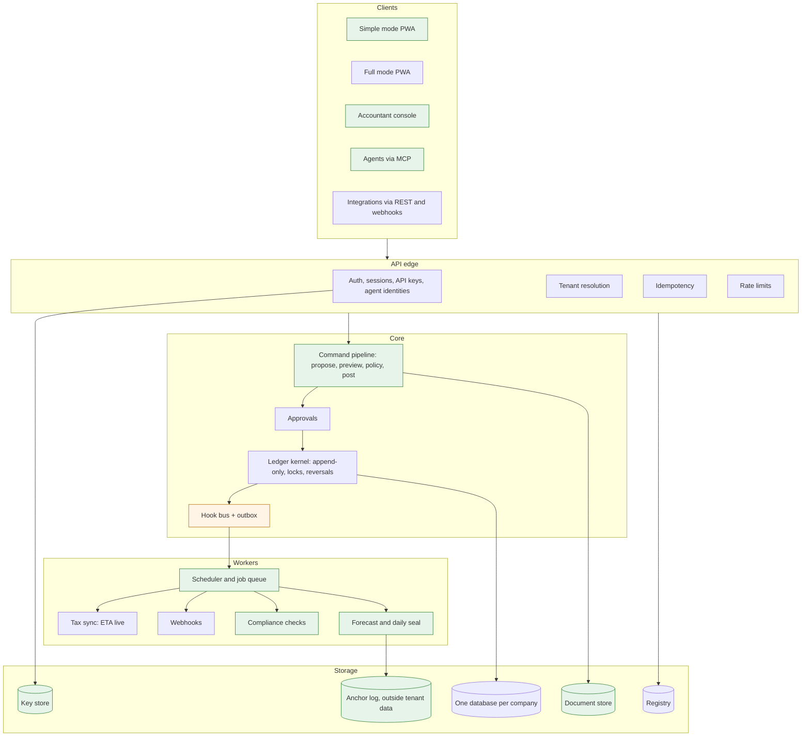

# Design plan: from feature-complete demo to a product merchants trust

Date: 2026-11-11. Status: proposal for the owner to confirm. Applies after milestone M5.

This document reviews the project against its requirements, names what is weak, proposes where the product can be
genuinely different, and gives a design and a phased plan to get there. It is the working design reference for milestones
M6 to M9. [ROADMAP.md](../ROADMAP.md) stays the short status page; [PLAN.md](PLAN.md) stays the history of M1 to M5.

**How to read it.** Sections 1 and 2 are the review. Section 3 is the product direction. Section 4 is the list of
innovation bets, ranked. Sections 5 to 7 are the design (architecture, data, experience). Sections 8 to 11 are the plan,
the measures, the risks and the decisions that need the owner.

Labels used throughout: **BUILT** (merged and tested), **PARTIAL** (exists, with a named gap), **MISSING**,
**MOCK** (works only against a stand-in), **UNVERIFIED** (a fact or format nobody has checked with the authority).

---

## 1. Review: where the project stands

### 1.1 What exists

Fourteen backend modules, about 9,900 lines of module code, 461 automated tests in 56 test files, five browser suites, CI
on every push, a Docker image and a hosting blueprint. Zero npm dependencies. In eight days the project went from an
idea to a system that covers most of the requirements document.

| Requirement (from the requirements doc) | Priority | Status | Gap to close |
| --- | --- | --- | --- |
| Append-only double-entry ledger, reversals with reason, audit trail | Must | BUILT | Audit chain key lives in the same database (see 5.7) |
| Egyptian chart of accounts template, editable | Must | BUILT | Numbering UNVERIFIED against Egyptian practice |
| Period lock, soft and hard; AI never writes to locked periods | Must | BUILT | Lock is global, not per entity |
| Invoices, quotes, partial payments, credit notes, Arabic and English | Must | BUILT | Reminders are generated on request; nothing sends or schedules them |
| Quick-sale screen: search, barcode, cash or wallet, print or share | Must | PARTIAL | Barcode is a typed lookup, no camera scan; no print or share of the receipt; no phone performance measurement |
| Customer credit tracking with WhatsApp-ready reminders | Must | BUILT | Link generator only; no "who should I chase today" view |
| Bills, supplier payments, expense capture with receipt photo | Must | PARTIAL | Attachments are API-only; no camera capture; extraction reads text, there is no OCR |
| ETA e-invoice and e-receipt, wizard, item codes | Must | MOCK | Live adapter exists but has only met a fake server; e-receipts still use the mock queue |
| Offline queue inside the 24-hour window, with deadline warning | Must | BUILT | Request replay, not a true operation log; one device per user assumed |
| Bank and wallet statement import, rules, reconcile | Must | BUILT | No Egyptian bank statement formats tested; no InstaPay or wallet reference matching |
| P&L, balance sheet, cash flow, aging, tax summary | Must | BUILT | No dimensions (branch, project); amounts not translated across currencies |
| Simplified-regime tax estimate | Should | PARTIAL | Present in the tax module as an estimate; rates UNVERIFIED |
| Inventory, low stock | Should | BUILT | One unit per item, whole quantities, no lots or expiry |
| AI assist in a review queue with reasons and undo | Should | MOCK | Keyword heuristic behind a provider interface; no model, no OCR, no voice |
| Approval rule | Should | BUILT (exceeds) | No scheduler, so escalation only runs when called |
| Full export, CSV import with mapping | Should | PARTIAL | Export is full; import covers bank lines and chart of accounts only. No migration from Excel or another tool |
| REST API and webhooks, published limits, no read fees | Should | BUILT | No versioned path (`/api/v1`), no usage meters, no agent (MCP) surface |
| Four role home views, fine-grained permissions, SoD, free time-boxed accountant seat | Must | BUILT | No multi-client console for an external accountant |
| MFA, isolation, backups with tested restore, encryption at rest | NFR | PARTIAL | Backups exist per tenant; no restore drill, no encryption at rest, no per-tenant keys |
| Quick sale under 1 s on a mid-range Android; list under 2 s at 10,000 records | NFR | MISSING | Never measured on a phone |
| Privacy law review, data residency decision | NFR | MISSING | Needs counsel |
| Flat published pricing | NFR | MISSING | No pricing page, no price experiment |

### 1.2 What the plan asked for and the project skipped

The requirements document put **Epic 0: Validate** first: confirm the ETA rules with the authority and an adviser, time
competitors' onboarding, interview 15 to 30 merchants and accountants, pick the pilot customer. **None of it has
happened.** Every one of the 14 modules was built on inference. This is the largest risk in the project and no amount of
further building reduces it. Section 8 puts a validation track beside the build track with explicit stop conditions.

### 1.3 Decisions that were made by building rather than by deciding

The requirements document listed seven architecture decisions "to make". Building made them. They should be recorded so
they are choices and not accidents (section 5.9 lists them as decision records).

| Decision | Proposed in requirements | What was built | Assessment |
| --- | --- | --- | --- |
| Ledger design | Append-only | Append-only, enforced by triggers | Right. Keep. |
| Multi-entity and currency | Fields from day one | Done | Right. Keep. |
| Tenancy | Shared database with tenant id | One SQLite file per company | Better isolation, trivial backup and export, enables per-company sandboxes (4.6). Costs: single process, no cross-tenant reporting. Keep through the pilot. |
| Stack | PostgreSQL, typed backend, React-like PWA | Node, built-in SQLite, vanilla JS, no dependencies | Excellent for speed and for an on-premise or offline box. The cost is recorded in `docs/tenancy.md`: 671 synchronous database calls in 71 files. Decide with criteria, not by drift (5.3). |
| Offline sync | Operation queue, client ids, conflict records | Request queue with idempotency keys | Good first step. Not yet multi-device (5.5). |
| Build or adopt | Spike ERPNext and Odoo | Built from scratch, no spike | Sunk. The remaining value of a spike is only to learn their ETA onboarding. |
| Hosting and residency | After legal check | Free-tier demo blueprint | Open. |

### 1.4 Honest critique

1. **Breadth beat depth.** The product has consolidation, intercompany eliminations and three-way matching, while the
   stall owner it is meant for still cannot scan a barcode with the phone camera or hand a customer a receipt. The wedge
   in the research was a merchant product; the build drifted toward a small ERP.
2. **It looks like accounting software.** The interface is pages of cards and forms organised by module (Sales, Ledger,
   Tax). A merchant thinks in *today*, *who owes me*, *am I legal*, *will I have cash on the 25th*. That is the opening.
3. **The differentiators are present but invisible.** Append-only ledger, audit hash chain, reversible assistant,
   free export, no seat tax: all built or free to promise, none of them something a user can *see or show someone else*.
4. **Everything external is a stand-in.** ETA, ZATCA, exchange rates, document reading, bank feeds. That is honest and
   labelled, but it means the hardest 20% (real integrations) is all still ahead.
5. **No clock.** There is no scheduler, so reminders, escalations, recurring bills, ETA sync and backups only happen when
   somebody clicks.
6. **Engineering debts worth naming:** `public/app.js` is one 600-line file that every module leans on; browser tests
   were timing-sensitive after each UI change; demo seeds and reference seeds are mixed, so a new company starts with
   sample data; secrets and the audit-chain key share the database they protect.

---

## 2. What changed outside since the research (checked 2026-11-11, all UNVERIFIED until confirmed with the ETA or counsel)

These come from a short web check and matter to the design. Each needs confirming before it drives a commitment.

- **E-receipt scope is per named taxpayer, not a turnover test.** A business is in scope when an ETA decision names it,
  it is already on e-invoicing, and its items are coded. The practical check is the ETA obligation inquiry by
  registration number. Design consequence: an *obligation status* record per company, checked and dated, instead of a
  threshold rule. Sources: [Invoice Data Extraction](https://invoicedataextraction.com/blog/egypt-electronic-receipt-compliance-guide),
  [ImageToTable](https://imagetotable.ai/blog/egypt-e-receipt-requirements).
- **The purchase side is now in play.** One source reports that since January 2025 a cost is deductible only when backed
  by an electronic invoice or receipt ([ImageToTable](https://imagetotable.ai/blog/egypt-e-receipt-requirements)).
  Design consequence: every expense should carry "has a valid e-document: yes, no, unknown", and the product can warn
  *before* tax time. No competitor claim of this was found.
- **Deadlines after issue.** Reported windows: a buyer may reject a B2B e-invoice within about 3 days, and a seller may
  request cancellation within 7 days ([VATupdate](https://www.vatupdate.com/?p=339313)). Design consequence: a deadline
  tracker per document.
- **Signing hardware expires.** Certificates on USB tokens are reported to last one to two years and an expired one stops
  submission ([Ecosire](https://ecosire.com/blog/odoo-egypt-localization-guide-2026), a vendor blog). Design consequence:
  an expiry countdown.
- **The ETA exposes lookup, notification and package-download flows** besides submission
  ([Invoice Data Extraction](https://invoicedataextraction.com/blog/egypt-e-receipt-requirements)). Design consequence:
  a three-way reconciliation of till, ledger and ETA is possible.
- **Payments.** InstaPay keeps growing and QR acceptance by small vendors is reported; the state of open banking is
  described inconsistently, from "framework under development" ([Fiskil](https://www.fiskil.com/open-finance-tracker/egypt))
  to "adopted in 2021" ([Open Banking Tracker](https://openbankingtracker.com/regulation/egypt-open-banking)). Design
  consequence: do not plan on bank APIs; plan on statements, references and QR.
- **Agents.** Trade press describes accounting vendors competing on how much bookkeeping software completes on its own
  ([IT Brief](https://itbrief.co.uk/story/accounting-software-faces-ai-rivals-in-bookkeeping-shift)), and firms being told
  to define where human checks belong ([CFOtech](https://cfotech.co.uk/story/ai-agents-shake-up-accounting-firms-bookkeeping-workflows)).
  Design consequence: the safe-AI position from the research is now the centre of the market argument, not a side note.

---

## 3. Product direction

### 3.1 Thesis

> **Books a merchant can prove.** The simplest daily book for an Egyptian shop, that keeps the shop legal by itself,
> and whose numbers can be shown to a bank, a partner or the tax office with proof that nobody altered them.

Three promises, each one something incumbents' business models make hard to copy:

1. **Legal without thinking.** The product watches the obligations, the deadlines and the documents, on both the sales
   and the purchase side, and says in one line whether the shop is fine today.
2. **Nothing changes behind your back.** People and software agents can only *propose*. Every posting can be previewed,
   has a named actor and a reason, and can be undone. The history is sealed and the seal can be checked by an outsider.
3. **Yours, at a price that does not move.** Flat price, free accountant and auditor seats, free full export, an open
   API with no read fees.

### 3.2 Who it is for (sharpened)

| Persona | Situation | The one job |
| --- | --- | --- |
| **Shop owner** (grocery, pharmacy-adjacent retail, stall with a registration) | Phone first, Arabic, sells partly on credit, afraid of fines, has an external accountant who visits monthly | "Tell me I am fine today, and who owes me" |
| **Counter clerk** | Shared Android phone or cheap tablet, patchy connection | "Never lose a sale, never be blamed" |
| **External accountant** | Looks after 10 to 40 small clients, is paid per client, chases paper | "Let me close all my clients' months from one screen" |
| **Lender or auditor** | Needs to trust numbers from a business with no audited statements | "Show me this was not edited last night" |
| **Integrator or agent builder** | Wants to connect a till, a store, or an AI assistant | "A stable API that cannot wreck the books" |

The external accountant is the distribution channel: one accountant brings tens of merchants. The free seat already
exists; the console for them does not (4.8).

### 3.3 Design principles

1. **Today first.** The home screen answers four questions: sold today, owed to me, am I legal, cash ahead.
2. **Two faces, one ledger.** A *simple mode* with no accounting words, and the *full mode* that exists now. Same data.
3. **Propose, preview, post.** No write path skips the preview and the actor record. Applies to people, imports and agents.
4. **Never lose a sale.** A sale is accepted on the device first, always.
5. **Show the proof.** Any number opens to its entries, documents and people. Any period can show its seal.
6. **Say what is not verified.** MOCK and UNVERIFIED stay visible in product and docs until they are not true.
7. **Stay light.** The app must run on a mid-range Android and on a small box in the back of a shop.

---

## 4. Innovation bets

Scored 1 to 5. *Evidence* is how well the need is supported (research or current code), not certainty of success.

| # | Bet | Merchant value | Hard to copy | Evidence | Effort | Order |
| --- | --- | --- | --- | --- | --- | --- |
| 4.1 | Simple mode: the daily book | 5 | 3 | 3 | M | **1** |
| 4.2 | Compliance autopilot | 5 | 4 | 4 | M | **2** |
| 4.3 | Propose, preview, post: one command pipeline, agent-ready | 4 | 5 | 4 | L | **3** |
| 4.4 | Provable books: seals, certificates, audit room | 4 | 5 | 3 | M | **4** |
| 4.5 | Speak or snap an entry (Egyptian Arabic) | 5 | 3 | 2 | M | 5 |
| 4.6 | What-if sandbox and time travel | 3 | 4 | 2 | S | 6 |
| 4.7 | Cash guardian and the daily close | 4 | 3 | 3 | M | 7 |
| 4.8 | Accountant console | 4 | 3 | 3 | M | 8 |
| 4.9 | Confirmed balances: the shared credit book | 4 | 4 | 2 | M | 9 |
| 4.10 | Merchant-owned credit passport | 3 | 4 | 1 | S (after 4.4) | 10 |
| 4.11 | Payment references and QR matching | 4 | 2 | 2 | M | 11 |
| 4.12 | Migration concierge | 3 | 2 | 3 | M | 12 |
| 4.13 | Shop box: local-first multi-device | 3 | 4 | 1 | L | later |

### 4.1 Simple mode: the daily book

**Idea.** A second shell for owners and clerks with no accounting vocabulary. Three verbs: *I sold*, *I bought*,
*I got paid / I paid*. One screen for today. Double entry happens underneath through the existing services.

**Why it is different.** Ledger-first apps (the Kippa and Vyapar pattern in the research) are simple but are not real
books; accounting tools are real books but not simple. Here the simple face writes to a real, sealed ledger, so the
merchant can grow into full mode, or hand the same data to an accountant, with no migration.

**Design.**
- `public/simple/` shell, chosen per user (setting `ui.mode = simple | full`), same API.
- Today screen: big total sold, cash in drawer, "owed to me" with the three oldest names, compliance light (4.2), next
  cash warning (4.7).
- Sell: item grid with search, camera barcode (`BarcodeDetector` where available, typed fallback), quantity stepper,
  *cash / wallet / on credit*, then share receipt (`navigator.share`, WhatsApp link, print stylesheet).
- Owed: customers sorted by days late; one tap opens the reminder; *paid* button takes a partial amount.
- Words: a glossary file maps ledger terms to shop words in Arabic and English, reviewed by a native speaker.
- Performance budget: first interaction under 1 s and sale submit under 300 ms locally on a throttled mid-range profile,
  checked in CI with Playwright throttling.

**Acceptance.** A first-time user completes a credit sale, a cash sale and a payment in under two minutes without help
(tested with five real people in the validation track). Every action appears correctly in full-mode reports.

### 4.2 Compliance autopilot

**Idea.** One status line, *"You are fine today"* or *"2 things need you"*, backed by a compliance calendar that the
product maintains itself.

**What it watches.**

| Check | Source | State |
| --- | --- | --- |
| Obligation status (in scope for e-invoice, e-receipt) | Dated record per company, re-checked on a schedule | UNVERIFIED process |
| Unsent receipts against the 24-hour window | Existing queue | BUILT |
| Buyer rejection window and seller cancellation window per document | Document dates | New |
| Signing certificate and token expiry | Certificate `notAfter`, already parsed by the live adapter | New |
| Items missing a tax code | Existing item-code mapping | BUILT |
| **Expenses with no valid e-document** (may not be deductible) | New flag on bills and expenses | New, UNVERIFIED rule |
| Till, ledger and ETA agree for the day | Three-way reconciliation using ETA lookup or package download | New |
| VAT return due date and estimate | Tax module | PARTIAL |

**Design.** A `compliance` module that owns an `obligations` table (kind, due, status, evidence, checked_at), fed by
hooks (`invoice.created`, `bill.created`, `sale.created`) and by scheduled jobs (5.4). Each obligation has a plain
sentence, a deadline, and one action. A daily digest can go to the owner (channel to be validated: WhatsApp link,
e-mail or in-app only).

**Why it is different.** Competitors claim *submission*. Nobody found in the research claims to watch the *purchase
side* or to reconcile the three records. It also gives the product a reason to be opened every day.

**Acceptance.** With the clock advanced, each check turns red at the right time and green after its action; the
three-way reconciliation finds a deliberately dropped receipt in a test.

### 4.3 Propose, preview, post: one command pipeline, agent-ready

**Idea.** Every change to the books, whoever asks for it, travels one path:

```
propose (actor, command, idempotency key)  ->  preview (ledger effect, checks, warnings)
   ->  policy (permission, limit, SoD, period lock, approval rule)  ->  post  ->  events  ->  seal
```

**Why.** The pieces exist separately today: idempotency keys (offline), approvals (bills only), the assistant's
review queue (bills only), dry runs (imports only). Unifying them gives three things at once:

1. **Preview everywhere.** Before posting anything, the user sees "this will debit X, credit Y, change receivables by Z,
   and it touches a soft-locked month".
2. **Safe agents.** An AI agent (ours or anyone's) gets an identity, a scope and limits like a person. Its default
   is *propose only*. An **MCP server** and the REST API expose the same commands. This is the practical answer to the
   documented complaint about silent AI edits, and it is hard for incumbents whose agents write directly.
3. **A complete actor record.** Human, API key, agent or system, on every entry.

**Design.**
- `src/commands.js`: a registry `{ name, schema, permission, preview(ctx, user, input), execute(ctx, user, input) }`.
  Modules register commands the way they register routes. Existing service functions become the `execute` bodies.
- `proposals` table: id, command, input, actor (type, id), preview snapshot, status (`proposed`, `approved`,
  `posted`, `rejected`, `expired`, `undone`), links to the approval request and the journal entry.
- Routes: `POST /api/v1/commands/:name?mode=preview|propose|post`. Old routes keep working by calling the registry.
- Actor types added to users and API keys: `agent` with `propose_only` (default) or bounded `auto_post` limits per
  command and per day; every agent action shows in a dedicated review queue with reasons and one-tap undo.
- MCP surface: read tools (reports, balances, documents) and the command tools. Stdio and HTTP transports. Written
  without dependencies if feasible; otherwise this is the first place a dependency is justified (decision D5).
- The assistant module becomes one client of this pipeline rather than a special case.

**Acceptance.** Property tests: for every registered command, `preview` followed by `post` yields exactly the previewed
journal lines; an agent key can never post beyond its limits; replay with the same key returns the same proposal.

### 4.4 Provable books

**Idea.** Make the append-only ledger and the hash chain something the owner can *show*.

- **Daily seal.** The scheduler seals each day and writes the head hash to an *anchor log* outside the tenant database:
  first a file and an e-mail to the owner, later a public transparency page listing only hashes.
- **Certificate.** A one-page, bilingual PDF or HTML: "Books of *Company*, period *P*, totals *T*, sealed with *H*,
  verified unchanged on *date*", with a QR to a verification endpoint that recomputes the chain.
- **Audit room.** A time-boxed, read-only link for an auditor, lender or buyer: reports, drill-down, the audit log and
  the verification result. Uses the existing time-boxed access and the auditor role.
- **Key separation.** The chain key moves out of the tenant database (5.7).

**Why it is different.** It turns an internal safeguard into the product's signature, and it is the base for 4.10.

**Acceptance.** Editing any historical row in a copied database makes verification fail and names the first broken day;
an anchor published yesterday detects a wholesale rewrite that recomputes the chain.

### 4.5 Speak or snap an entry

**Idea.** "بعت لأحمد ٣ كراتين زيت بـ ٤٥٠ آجل" spoken or typed becomes a proposed credit sale. A photo of a supplier bill
becomes a proposed bill. Both go through 4.3 and are never posted without a tap.

**Design.** Keep the provider interface in the assistant module. Providers: the current heuristic (default, offline),
and a model-backed provider configured per company with its own key (speech-to-text plus extraction). Store the
transcript or image as the source document on the proposal. Measure accuracy on a labelled set of real Egyptian
receipts and phrases collected in the pilot (the research found no independent benchmark worth trusting).

**Risks.** Dialect accuracy, cost per entry, privacy of audio. Start typed, then voice, and only where interviews show
merchants want it.

### 4.6 What-if sandbox and time travel

**Idea.** Because each company is one file, a full copy is nearly free. Offer *"Try it on a copy"*: clone the books into
a sandbox company, change prices, add a loan, hire someone, post a year-end, and compare reports with the real books.
The same mechanism gives training mode for new clerks and a safe target for agent experiments.

Time travel already half exists: an append-only ledger can answer any report *as of* any date. Expose an "as of"
control on every report and a "what changed since" diff between two dates.

**Design.** `POST /api/tenants/:slug/sandbox` (copy with `VACUUM INTO`, mark `sandbox = true`, disable outbound ETA and
webhooks, auto-expire). A banner in the UI. A compare endpoint that runs one report on two databases.

### 4.7 Cash guardian and the daily close

- **Forecast.** Thirteen-week cash view from open receivables weighted by each customer's payment history, approved
  bills, recurring bills and the weekly sales pattern. Deterministic and explainable first; no model needed.
  The alert is a sentence: "On the 24th you may be short by about EGP 12,000; these three customers are late."
- **Daily close.** A sixty-second ritual: count the drawer, confirm wallet total, send pending receipts, back up, seal.
  Differences post to an over/short account with a reason. A streak counter makes it a habit; the seal (4.4) is its
  reward.

### 4.8 Accountant console

A cross-company view for an external accountant holding free seats in many companies: per client, the month-close
checklist (bank reconciled, receipts sent, VAT estimate, open questions), a request thread to the owner ("send me the
missing bill"), and bulk period locking. It needs a cross-tenant identity (the registry already maps credentials to
tenants) and read-only fan-out queries. This is the growth channel in 3.2.

### 4.9 Confirmed balances: the shared credit book

When a merchant sends a statement or reminder link, the customer can open it without an account and tap *I agree* or
*I disagree, because…*. A confirmed balance is recorded with time and device. Disputes about credit are the daily
friction of informal retail; a confirmation history is something a paper notebook cannot give. Privacy and abuse need
care: links are single-purpose, expire, and show only that customer's lines.

### 4.10 Merchant-owned credit passport

An export, signed with the seal from 4.4, of twelve months of sales, collections and cash position that the merchant
may hand to a lender. The product does **not** lend or score. It gives small businesses, who usually have no audited
statements, verifiable history. Build only after partner interviews; structures compatible with Islamic finance
should be asked about in those interviews.

### 4.11 Payment references and QR matching

Put a payment reference and, where permitted, a QR on invoices and receipts; match incoming wallet or bank lines by
reference before falling back to the existing scoring. Add tested parsers for the statement formats pilot merchants
actually have. Everything here is UNVERIFIED until a merchant's real statements are in hand.

### 4.12 Migration concierge

Import customers, items, opening balances and open invoices from spreadsheets and from a competitor's export, with
column mapping, duplicate detection and an opening-balance check that must tie before commit. The research called
migration the costliest and least served step; today only bank lines and the chart of accounts can be imported.

### 4.13 Shop box (later)

A small local server (the app already runs with no dependencies on anything that runs Node) that several tills in one
shop sync to without internet, and that syncs upward when a connection exists. Needs the operation-log sync in 5.5.

---

## 5. Target architecture

### 5.1 Shape



Green is new, amber changes, the rest exists.

### 5.2 Module map after the change

| Layer | Existing | New or changed |
| --- | --- | --- |
| Kernel | `ledger`, `permissions`, `hooks`, `db`, `idempotency`, `tenants` | `commands` (registry and pipeline), `jobs` (scheduler), `outbox` |
| Domain | `sales`, `purchases`, `inventory`, `banking`, `entities`, `reports`, `tax`, `eta` | `compliance`, `forecast`, `documents` (attachments and source files), `dimensions` |
| Control | `auth`, `approvals`, `assist` | agent identities in `auth`; `assist` becomes a pipeline client; `proof` (seals, certificates, audit room) |
| Surfaces | REST, webhooks, full PWA, offline client | `/api/v1`, MCP server, simple-mode shell, accountant console |

The module contract, migration ranges and ownership rules in [ARCHITECTURE.md](ARCHITECTURE.md) stay. New ranges:
`920-939 commands and jobs`, `940-959 compliance`, `960-979 proof and documents`, `980-999 forecast and dimensions`.

### 5.3 Storage decision (record as D1)

**Stay on one SQLite file per company through the pilot.** Reasons: isolation by construction, instant backup, export and
sandbox, no operations burden, and it is what makes the shop box (4.13) possible. Make it safe to run:

- continuous replication of each file to object storage plus a **monthly restore drill in CI** against a real backup;
- write-ahead logging and a busy timeout set once in `openDb`;
- a load test that states the measured ceiling (companies per process, sales per second).

**Move to PostgreSQL only when one of these is true:** a second application process is required for availability; a
customer contract demands it; cross-company analytics are needed in the product; or measured write contention exceeds
the stated ceiling. If that day comes, the route is schema-per-tenant and an async data layer, as analysed in
[tenancy.md](tenancy.md). Until then, keep new code port-friendly: all SQL in service files, no new SQLite-only syntax,
`RETURNING` instead of `lastInsertRowid` in new code.

### 5.4 Scheduler, jobs and outbox

- `jobs` table per company: `kind, run_at, payload, attempts, locked_until, last_error, unique_key`.
- One loop per process leases due jobs across open tenants (the tenant manager already iterates them for webhooks).
  Handlers are registered by modules, like hooks: `jobs: { 'tax.sync': fn, 'approvals.escalate': fn }`.
- Recurring definitions: `schedules` table with a simple interval or daily-at rule, evaluated with `ctx.now()` so the
  demo clock and tests can drive time.
- **Outbox.** Hooks that cause external effects (webhooks, ETA submission, notifications) write an outbox row in the
  same transaction as the posting; a job delivers it. This removes the last places where an external call sits near a
  ledger transaction.
- First jobs: ETA sync, approval escalation, recurring bills, reminders due, daily seal and anchor, backup,
  compliance checks, idempotency-key cleanup.

### 5.5 Sync, version 2

Today: the client queues HTTP requests and replays them with idempotency keys. Limits: one device, order blocking, and
the server computes totals the client only estimated.

Target, in two steps:
1. **Operation log.** The client records domain operations (`sale.create` with a client-generated id, lines, prices as
   seen, device id, local time), not raw requests. The server accepts each operation exactly once, records what it
   changed (for example a price that differed) as a *conflict note* on the entry rather than rejecting the sale, and
   returns a cursor. Reads sync by cursor per collection.
2. **Multi-device.** Several tills per shop; receipt numbers allocated in per-device blocks; stock conflicts become
   negative-stock flags (already supported) rather than failures.

A sale made offline is never refused later for a reason the clerk could not have known. Anything the server disagrees
with becomes a note for the owner.

### 5.6 Data model additions

| Table (owner) | Purpose | Key fields |
| --- | --- | --- |
| `proposals` (commands) | Every requested change | command, input, actor_type, actor_id, preview, status, entry_id, approval_id, idempotency_key |
| `jobs`, `schedules`, `outbox` (jobs) | Time and delivery | see 5.4 |
| `obligations` (compliance) | Compliance calendar | kind, subject_type, subject_id, due_at, status, evidence, checked_at |
| `documents` (documents) | Source files for anything | sha256, mime, size, storage_ref, ocr_text, linked_type, linked_id |
| `dimensions`, `line_dimensions` (dimensions) | Branch, project, salesperson tags on journal lines | dimension_id, value_id, line_id |
| `seals`, `anchors` (proof) | Daily seals and where each was published | day, head_hash, entry_count, anchor_ref |
| `share_links` (proof) | Audit room and customer confirmation links | scope, expires_at, token_hash, last_used_at |
| `confirmations` (sales) | Customer balance confirmations | customer_id, balance, agreed, note, at |

Unify `customers` and `suppliers` under a `parties` view later; do not block on it.

### 5.7 Security and privacy

- **Keys out of the data they protect.** Envelope encryption: a per-company data key encrypts secrets and the
  audit-chain key; data keys are wrapped by a master key from the environment or a key service. Closes the limit noted
  in [security.md](security.md).
- **Encryption at rest** for database files and the document store (volume-level first; SQLite page encryption only if a
  dependency is accepted).
- **Agent identities** are first-class principals with scopes, limits, expiry and their own audit filter.
- **Share links** are single-purpose, hashed at rest, expiring, rate-limited and revocable.
- **Privacy.** A data map (what personal data, where, why, retention) and an erasure approach that redacts party details
  while leaving journal amounts intact; both need counsel (11).
- **Threat review** before any real merchant: sign-in, tenancy, webhooks, share links, uploaded files, agent surface.

### 5.8 Front end

Keep the no-build approach, and pay down the single-file debt:

- split `public/app.js` into ES modules (`core/api.js`, `core/state.js`, `core/router.js`, `ui/kit.js`, `i18n.js`);
- a small component kit (list, form, sheet, money input, date, chip) used by both shells;
- `public/simple/` shell for 4.1 sharing the kit and the offline client;
- one deterministic readiness signal (`App.ready` promise and a `data-ready` attribute) so browser tests stop waiting on
  timers;
- performance budgets enforced in CI (bundle bytes, time to interactive under throttling).

### 5.9 Decision records to write (`docs/adr/`)

| Id | Decision | Proposed outcome |
| --- | --- | --- |
| D1 | Database through the pilot | SQLite per company, with the triggers in 5.3 |
| D2 | Tenancy model | File per company (built); schema-per-tenant if ported |
| D3 | Front-end approach | No build step, ES modules, two shells |
| D4 | Sync model | Operation log (5.5) |
| D5 | Dependency policy | Zero by default; allow a named, reviewed exception list (MCP SDK, PDF, a crypto or OCR binding) with reasons |
| D6 | AI provider | Pluggable, company-supplied key, propose-only default |
| D7 | Hosting and residency | Open until counsel answers |
| D8 | API versioning | `/api/v1` now; unversioned paths kept as aliases through the pilot |

---

## 6. Experience design

### 6.1 Simple-mode home (phone)

```
┌──────────────────────────────┐
│ اليوم · Today        ● Fine  │  <- compliance light (4.2), tap for the list
│                              │
│   EGP 4,820  sold today      │
│   Drawer 3,150 · Wallet 1,670│
│                              │
│ Owed to you      EGP 12,400  │
│  Ahmed S.   2,300   12 days ›│
│  Nile Mkt   5,100    9 days ›│
│  Mona K.      900    7 days ›│
│                              │
│ Cash ahead  ⚠ short on 24th ›│  <- guardian (4.7)
│                              │
│ [  SELL  ] [ BOUGHT ] [ PAID ]│
│                Close the day ›│
└──────────────────────────────┘
```

### 6.2 Preview sheet (every posting, both modes)

```
You are about to: Credit sale to Ahmed S.
  + Receivable  Ahmed S.     EGP 450.00
  + Sales                    EGP 394.74
  + VAT 14%                  EGP  55.26
  Stock: Oil 1L  −3 (leaves 9)
  ⚠ Ahmed will be EGP 250 over his limit
[ Post ]   [ Save as draft ]   [ Cancel ]
```

### 6.3 Agent review queue

Each row: who (agent name), what it proposes, why (its reasons and source document), the preview, confidence, and
*Approve / Edit / Reject*. Approved items keep an *Undo* for a configurable time. A header shows the agent's accuracy
over its last reviewed items with the sample size, as the assistant module does today.

### 6.4 Key journeys to test with real users

1. First run: company name to first receipt shared, target under five minutes.
2. Credit sale, reminder, partial payment, confirmation by the customer.
3. Connection lost for a day; forty sales; reconnect; close the day.
4. Accountant closes the month for three clients from the console.
5. Owner opens an audit room for a bank officer and revokes it.

---

## 7. Quality and operations

- **Invariants as property tests:** trial balance always zero; preview equals post; replay is idempotent; seals verify;
  inventory value equals account 1300; no agent exceeds limits.
- **Sync simulator:** randomised sequences of offline operations, duplicates, reordering and crashes against the server.
- **Contract tests for ETA:** recorded request and response fixtures from the real preproduction system once
  credentials exist, replacing assumptions one by one.
- **Operations:** structured logs exist; add metrics (requests, job lag, queue depth, sync failures, ETA rejections),
  a status endpoint per company, a restore drill, and a written incident checklist.
- **Releases:** finish the release automation (needs the repository secret described in [RELEASING.md](RELEASING.md)).

---

## 8. Plan

Two tracks run together. **The validation track can stop or redirect the build track.**

### 8.1 Validation track (owner-led, starts now)

| Step | Output | Stop or change if |
| --- | --- | --- |
| V1 Ten merchant and five accountant conversations, with the simple-mode prototype on a phone | Notes, ranked pains, what they pay today | Fewer than 3 in 10 merchants want a phone book that keeps them legal |
| V2 ETA facts with an adviser: who is in scope, purchase-side rule, deadlines, archive location | A signed-off fact sheet replacing section 2 | The purchase-side rule is not real: drop that check |
| V3 Onboard on two competitors and time it | Minutes and blockers per step | Their onboarding is already under 30 minutes: compliance is not the wedge, lead with 4.1 and 4.4 |
| V4 ETA preproduction credentials and one real submission | Fixture set | Signing requires hardware we cannot reach from a server: design the shop box or a local signer first |
| V5 Price test: three flat prices shown to interviewees | Chosen price | Nobody accepts any of them |

### 8.2 Build track

Every item ships on its own branch through a pull request with tests, as M5 did.

**M6: The merchant's day** (about 3 weeks of focused work). Bets 4.1, 4.2 and the scheduler.
- `feat/jobs-scheduler`: jobs, schedules, outbox; move webhook delivery, escalation, recurring bills and ETA sync onto it.
- `feat/compliance-autopilot`: obligations, the eight checks, status line, daily digest.
- `feat/simple-mode`: shell, today screen, sell with camera barcode and share, owed, paid, glossary.
- `refactor/app-modules`: split `app.js`, readiness signal, performance budget in CI.
- `feat/documents`: document store, camera capture on bills, attachment screens.
- Exit: journeys 1 to 3 pass in browser tests on a throttled phone profile; all checks proven with the demo clock.

**M7: Trust you can show** (about 3 weeks). Bets 4.3, 4.4, 4.6.
- `feat/command-pipeline`: registry, proposals, preview on every write, `/api/v1`.
- `feat/agent-identities` and `feat/mcp-server`: propose-only agents, review queue, limits.
- `feat/proof`: daily seal, anchor log, certificate, audit room, key separation.
- `feat/sandbox`: copy-on-demand company and report compare; "as of" on every report.
- Exit: property tests for preview equals post; tamper tests; an external agent completes a bookkeeping task through MCP
  with zero unapproved postings.

**M8: Money and people** (about 3 weeks). Bets 4.5, 4.7, 4.8, 4.9, 4.12.
- `feat/cash-guardian`, `feat/daily-close`, `feat/accountant-console`, `feat/confirmations`, `feat/migration-import`,
  `feat/assist-providers` (model-backed provider, typed then voice).
- Exit: journeys 4 and 5; forecast back-tested on pilot data; an accuracy report for the assistant with sample size.

**M9: Pilot and scale** (elapsed time set by merchants, not code).
- Three to five merchants for four weeks; weekly fixes.
- `feat/sync-v2` operation log and multi-device; `feat/payment-references`; restore drill; threat review; privacy work.
- Decide D1 again with measured load; decide the shop box.

### 8.3 Issue seeds

Create one GitHub milestone per phase and one issue per branch above. Suggested first ten issues, in order:
scheduler; outbox; compliance obligations model; simple-mode shell; camera barcode and share; app.js split and
readiness signal; documents store; split demo and reference seeds; restore drill; ADR folder with D1 to D8.

---

## 9. How we will know it works

| Measure | Target for the pilot |
| --- | --- |
| **North star:** merchants who close the day on 4 or more days a week | 3 of 5 pilot merchants by week 3 |
| Time from sign-up to first shared receipt | under 5 minutes |
| Sales lost or duplicated by sync | zero |
| Compliance items resolved before their deadline | over 95% |
| Agent or assistant proposals accepted without edit | reported with sample size; no target until 200 reviews |
| Unapproved postings by any agent | zero |
| Quick-sale response on a mid-range Android | under 1 second |
| Accountant time to close a client month | measured, then halved |

---

## 10. Risks

| Risk | Effect | Response |
| --- | --- | --- |
| Building continues without validation | A polished product nobody asked for | Track 8.1 with stop conditions; M6 is shaped to produce the prototype those conversations need |
| Real ETA differs from assumptions | Rework in the adapter and signing | Fixture-driven contract tests; every assumption is already listed in `eta-live.md` |
| Signing needs a physical token | No server-side submission | Pluggable signer exists; design a local signer or the shop box |
| Simple mode hides too much | Wrong books made easily | Preview sheet on every posting; accountant console; full mode one tap away |
| Agent surface is abused | Bad entries or data exposure | Propose-only default, limits, scopes, review queue, audit filter, threat review |
| SQLite ceiling reached | Slow or unavailable service | Measured ceiling, replication, written triggers for a port |
| Share links leak data | Privacy harm | Single-purpose, expiring, hashed, revocable, minimal content |
| Scope keeps widening | Nothing reaches a merchant | Each milestone has at most five branches and one exit test; "later" items stay later |

---

## 11. Decisions and inputs needed from the owner

1. Confirm the thesis in 3.1 and the order of bets in section 4, or reorder them.
2. Start the validation track: who are the first ten merchants and five accountants?
3. An Egyptian tax adviser for V2, and ETA preproduction credentials for V4.
4. Confirm D1 (stay on SQLite per company through the pilot) and D5 (allow a short, reviewed dependency list).
5. Counsel for privacy and data residency.
6. The repository secret for releases, so milestones can be tagged.
7. Whether AI model keys are supplied by each company or by the service (cost and privacy trade-off).

---

## Appendix: sources for section 2

Checked on 2026-11-11. Mostly consultancies and vendor blogs; treat as leads, not law.

- Invoice Data Extraction, Egypt e-receipt guides: <https://invoicedataextraction.com/blog/egypt-electronic-receipt-compliance-guide>, <https://invoicedataextraction.com/blog/egypt-e-receipt-requirements>
- ImageToTable, Egypt e-receipt requirements: <https://imagetotable.ai/blog/egypt-e-receipt-requirements>
- VATupdate, Egypt e-invoicing overview: <https://www.vatupdate.com/?p=339313>
- Ecosire, Odoo Egypt localization (vendor blog): <https://ecosire.com/blog/odoo-egypt-localization-guide-2026>
- Fiskil open finance tracker, Egypt: <https://www.fiskil.com/open-finance-tracker/egypt>
- Open Banking Tracker, Egypt: <https://openbankingtracker.com/regulation/egypt-open-banking>
- IT Brief, accounting software and AI rivals: <https://itbrief.co.uk/story/accounting-software-faces-ai-rivals-in-bookkeeping-shift>
- CFOtech, AI agents in accounting firms: <https://cfotech.co.uk/story/ai-agents-shake-up-accounting-firms-bookkeeping-workflows>
- Earlier research report "Accounting software landscape and gaps" and the requirements document (project docs).
